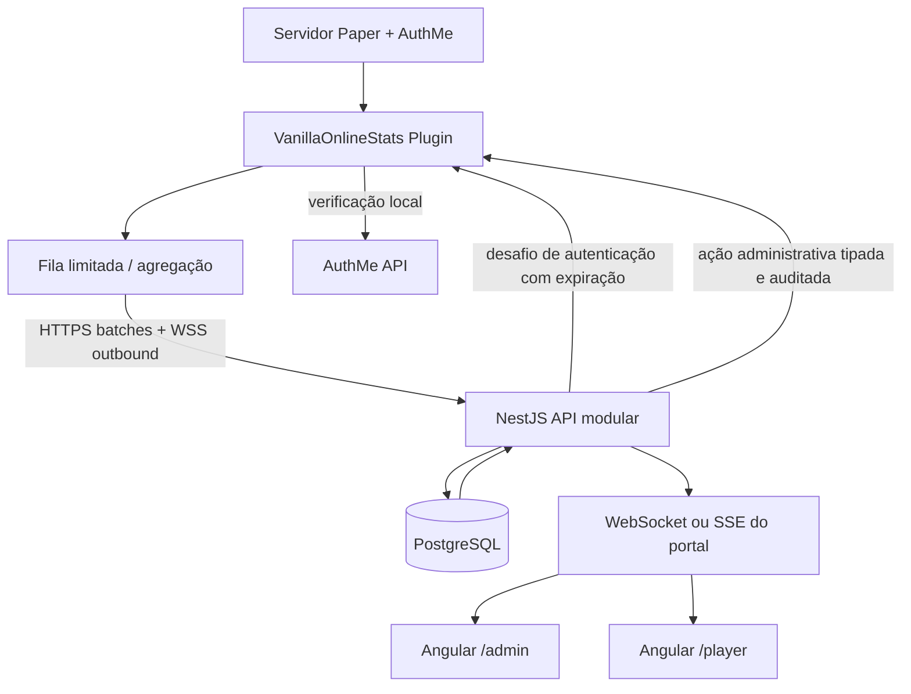

# VanillaOnlineStats

> **Documento mestre de produto, requisitos e arquitetura**  
> Estado: `DRAFT-002 — decisões de produto ratificadas; base normativa para implementação`  
> Data de referência: **28/10/2026**  
> Público: mantenedores, contribuidores, administradores de servidores Paper e jogadores.  
> Idioma principal do projeto: **português (pt-BR)**; código, contratos de API e identificadores em **inglês**.  
> Repositório GitHub: **a definir** (não presumir uma URL).

---

## 0. Como interpretar este documento

Esta especificação consolida os requisitos, o brainstorm inicial e as decisões do mantenedor do **VanillaOnlineStats**. A revisão DRAFT-002 fixa o modelo self-hosted → SaaS, administração remota restrita ao Admin, visibilidade administrativa integral dos dados coletados e licença principal. Ela deve orientar implementações, revisão de PRs, arquitetura e roadmap. Sempre que surgir conflito entre velocidade de entrega e os princípios de segurança, confiabilidade, compatibilidade e baixo impacto no TPS, os princípios prevalecem.

**Vocabulário normativo:**

- **OBRIGATÓRIO / DEVE:** requisito indispensável para a release ou módulo indicado.
- **RECOMENDADO / DEVERIA:** padrão adotado, salvo decisão técnica documentada.
- **OPCIONAL / PODERÁ:** extensão planejável.
- **PROIBIDO / NÃO DEVE:** comportamento contrário aos objetivos do projeto.
- **`MVP`, `V1`, `FUTURO`:** escopo da entrega. Uma funcionalidade marcada como `FUTURO` **não** é prometida na versão inicial.
- **`DECIDIDO`, `PROPOSTO`, `PENDENTE`, `EXPERIMENTAL`:** estado da decisão.

Este documento **não afirma que a API Paper permite literalmente recuperar cada informação interna de Minecraft**. O objetivo principal é a **maior cobertura prática, documentada, verificável e sustentável possível das APIs públicas expostas pela versão de Paper suportada**, acrescida de observação de eventos, métricas da JVM e integrações explícitas. Alguns dados exigem processamento, profiling, histórico prévio, permissões, tecnologias externas ou nem sequer estão disponíveis ao servidor.

### 0.1 Decisões já fechadas

| ID | Decisão | Estado |
|---|---|---|
| D-001 | O nome do projeto é **VanillaOnlineStats**. | DECIDIDO |
| D-002 | O núcleo é um plugin **Paper** para servidores Survival/Vanilla; não altera a jogabilidade por padrão. | DECIDIDO |
| D-003 | O **AuthMeReloaded é dependência obrigatória** do plugin. | DECIDIDO |
| D-004 | O portal tem **Área Admin** e **Área Player**, com isolamento de permissões e dados. | DECIDIDO |
| D-005 | O Player usa **nickname + senha do AuthMeReloaded**, quando sua modalidade de conta suportar senha. | DECIDIDO |
| D-006 | O projeto será **open source no GitHub**, pensado para manutenção e crescimento de compatibilidade. | DECIDIDO |
| D-007 | O plugin deve capturar o máximo dos **dados observáveis suportados pelo Paper** sem causar lag relevante. | DECIDIDO |
| D-008 | Arquitetura **monorepo com módulos separados**, contratos versionados e limites claros entre plugin/API/frontend. | DECIDIDO |
| D-009 | O **Admin DEVE possuir recursos de controle remoto** do servidor, além da observabilidade; **nenhum Player pode executar operações administrativas**. Entrega progressiva por risco, com ações sensíveis desativadas até explicitamente habilitadas. | DECIDIDO |
| D-010 | **Self-hosted primeiro**; futuramente, oferecer **SaaS central hospedado e pago** pelo mantenedor, com a mesma base arquitetural. | DECIDIDO |
| D-011 | **Admin tem autoridade máxima sobre o servidor sob sua gestão e acesso a todos os dados que a instalação coletar**, inclusive inventários, ender chests e coordenadas, respeitados segredos de autenticação e obrigações legais. | DECIDIDO |
| D-012 | Licença do **código original do VanillaOnlineStats: AGPL-3.0-only**; dependências externas preservam suas licenças; contribuições via DCO. | DECIDIDO — recomendação adotada para publicação, sujeita a revisão jurídica de distribuição |
| D-013 | Modelo de **tenant/servidor desde o início** para migração futura ao SaaS, sem implementar cobrança nem dependência de cloud no MVP. | DECIDIDO |

## 1. Visão, propósito e escopo

**Visão:** tornar visível, acessível e historicamente pesquisável a vida de um servidor Survival — tanto para o proprietário quanto para cada jogador — por meio de uma solução confiável e de baixo impacto.

**Proposta de valor para o administrador:** acesso completo à observabilidade e aos dados coletados do servidor, com ações de gerenciamento, moderação e controle remoto do gameplay e das configurações, sempre por canal autenticado e auditado.

**Proposta de valor para o jogador:** entrar em um portal com a identidade que já usa no servidor e acompanhar sua jornada — progresso, inventário quando autorizado, conquistas, mortes, sessões, exploração, comparativos e evolução.

**Público-alvo:** comunidades privadas e públicas de Survival, vanilla-like, SMP e servidores pequenos/médios. Grande escala e redes de servidores fazem parte da evolução, não da promessa inicial.

**Não objetivos iniciais:** criar um novo sistema de autenticação Minecraft; substituir AuthMe; **alterar o gameplay automaticamente** (o Admin poderá modificá-lo de forma deliberada); executar rollback de mundo completo sem integração própria; espionar jogadores; coletar dados de clientes Minecraft sem consentimento; oferecer proxy próprio; prometer 100% de eventos passados; ou acessar APIs internas instáveis como dependência normal.

### 1.1 Princípios inegociáveis

1. **Vanilla-friendly:** por padrão somente observar; nenhum efeito no gameplay.
2. **Paper primeiro, expansão progressiva:** otimizar compatibilidade por adaptadores e matriz testada.
3. **AuthMe é a fonte de autenticação do Player:** nunca duplicar hashes ou criar senha independente sem decisão formal.
4. **Privacidade e autoridade administrativa:** o Admin pode ver **todos os dados legitimamente coletados** de seu servidor; coleta, retenção e compartilhamento permanecem sujeitos a configuração, classificação e legislação. Credenciais e segredos nunca são expostos, nem ao Admin.
5. **Coleta não pode derrubar o servidor:** budgets, amostragem, backpressure, limites e degradação controlada.
6. **Dados honestos:** mostrar origem, última atualização, precisão e indisponibilidade.
7. **Versionamento em todas as fronteiras:** API, payloads, banco e plugin evoluem sem romper instalações existentes.
8. **Código contribuível:** documentação, testes, lint, padrões de revisão, releases e suporte público.
9. **Self-hosted sem dependência comercial:** todas as funções essenciais funcionam sem SaaS, conta externa paga, chave comercial ou servidores controlados pelo mantenedor.
10. **Comandos somente com autorização administrativa:** nunca permitir mutação de estado por Player, endpoint público ou agente sem verificação no backend e no plugin.

## 2. Personas e fluxos principais

### 2.1 Persona: administrador/dono do servidor

1. Instala Paper e um build compatível do AuthMeReloaded.
2. Instala `VanillaOnlineStats.jar`; o plugin **não inicia sem `AuthMe`** ou versão incompatível.
3. O plugin cria configuração, uma identidade local da instalação e exibe um **código de vinculação temporário** no console (nunca uma credencial persistente em claro).
4. O dono sobe o portal local/self-hosted e cria sua conta Admin (mecanismo independente, com MFA recomendado).
5. Confirma posse do servidor usando o código de vinculação e recebe uma credencial de máquina rotacionável.
6. O plugin inicia **conexões de saída** protegidas para a API e envia heartbeat e lotes de telemetria.
7. O Admin configura quais coletores estão ativos, períodos, retenção, limites, visibilidade pública e alertas.
8. Acessa overview, jogadores, mundos, performance, logs auditáveis, relatórios e diagnósticos, **inclusive inventários/ender chests/coordenadas quando coletados**.
9. Controla o servidor pelo portal com **ações tipadas de moderação e administração** conforme forem implementadas (kick, ban, whitelist, tempo, clima, gamerules, gamemode, teleportes, comandos etc.). Somente contas Admin/Owner possuem essas permissões; toda execução exige autenticação, escopo, auditoria e proteções específicas.
10. No modo SaaS futuro, o mesmo processo de vinculação associa o agente a um **tenant** do serviço hospedado. O administrador paga pelo serviço de hospedagem/gestão, **não pelo direito de usar o código open source self-hosted**.

### 2.2 Persona: jogador

1. Registra-se / autentica-se normalmente no Minecraft pelo AuthMeReloaded.
2. Após a confirmação de autenticação no jogo, o plugin associa atividade à **identidade estável da conta naquele servidor**.
3. O Player acessa o portal, seleciona o servidor, fornece nickname + senha AuthMe.
4. A API solicita validação ao plugin pelo **canal privado e online**, sem armazenar senha; uma política central verifica bloqueios, limitação de tentativas e fatores adicionais.
5. O AuthMe verifica a senha; o backend emite uma sessão web com escopo `serverId + playerId`.
6. O Player acessa dados próprios, dashboards, rankings permitidos, cronologia e preferências de privacidade.
7. Se o Paper cair, o histórico permanece visível em **sessões web existentes válidas**; novo login por senha via plugin fica indisponível.
8. Alterações de senha, desvinculação, banimento ou revogação de conta devem invalidar ou reduzir sessões conforme a política de segurança.

### 2.3 Casos especiais de autenticação

- **Premium auto-login, sessão restaurada, proxy, TOTP/2FA, recuperação de conta:** o sistema não pode considerar que `checkPassword` isoladamente corresponde a toda a política de autenticação do AuthMe. O login web deve ser **bloqueado** ou usar um fluxo separado de vinculação/confirmação dentro do jogo, revisado contra as regras de segurança aplicáveis.
- **Conta premium sem senha AuthMe:** ofertar **código temporário de vinculação dentro do jogo** e uma identidade web sem criar uma senha fictícia no AuthMe; registrar a alternativa como exceção explícita ao fluxo convencional.
- **Nickname alterado e UUID:** persistir uma chave interna `player_id`, nome normalizado, aliases históricos, identificadores declarados por AuthMe e UUID(s) com origem documentada; **não confiar apenas no nickname nem presumir equivalência entre UUID premium/offline**.
- **Conta sem login no jogo:** não publicar estatísticas privadas nem vincular automaticamente por semelhança de nome.
- **Servidor offline:** credenciais do AuthMe não são exportadas para a API; sem validação online, a API não deve prometer novo login baseado apenas em senha.

## 3. Modelo de permissões e privacidade

| Ator | Permissões padrão |
|---|---|
| Visitante | Landing page, informações públicas explicitamente habilitadas, sem PII. |
| Player | Seu perfil, suas estatísticas e configurações de privacidade. |
| Moderador (`FUTURO`) | Ações restritas por escopo e auditoria, sem acesso a segredos por padrão. |
| Admin | **Acesso administrativo pleno ao servidor vinculado:** todos os dados disponíveis/coletados e todas as ações administrativas implementadas e habilitadas para aquela instalação. Nunca permissão de outro servidor/tenant nem acesso a senhas/segredos. |
| Owner | Todas as capacidades de Admin **mais** posse do vínculo, gestão de outros administradores, chaves de agente, titularidade, exclusão e, no futuro SaaS, plano/cobrança. |
| Agent/Plugin | Apenas ingestão e execução de solicitações técnicas especificamente autorizadas. |

Regras obrigatórias:

- Autorização no **backend**, em cada consulta/escrita; guards de frontend apenas melhoram UX.
- `tenantId + serverId` identificam o contexto de toda consulta e escrita desde a primeira versão; no self-hosted existe um tenant local por padrão. O agente nunca escolhe outro tenant só por alterar um campo no payload.
- A identidade do proprietário **não** decorre de nickname `admin` ou da flag OP do Minecraft.
- **Admin/Owner podem consultar todos os dados legitimamente coletados sobre jogadores de seus servidores**, inclusive inventários, ender chests, coordenadas, posições históricas, IPs e eventos sensíveis quando habilitados e armazenados; consultas e exportações sensíveis geram auditoria.
- **Player não consulta dados privados de outros jogadores** (inventários, ender chest, IP, coordenadas, atividade privada ou comandos), nem ganha acesso administrativo por nickname, OP, token forjado, endpoint oculto ou manipulação do frontend.
- A expressão **“acesso supremo do Admin” não inclui senhas do AuthMe, hashes, tokens, chaves privadas, códigos de recuperação ou segredos de infraestrutura**; tais valores jamais integram catálogo, telemetria ou tela, e o controle do tenant continua com o Owner.
- Definir visibilidade `PRIVATE`, `PUBLIC_OPT_IN`, `ADMIN_RESTRICTED`, `SYSTEM`; registrar origem e base legal de dados pessoais.
- Chat e conteúdo de comandos são **opt-in desativado por padrão**; nunca registrar senha de `/login`, `/register`, `/changepassword` ou tokens. Auditoria de comandos deve operar com **lista de comandos seguros permitidos**, e não captura irrestrita.
- IP, e-mail AuthMe, geolocalização, inventários, ender chest, coordenadas precisas e histórico detalhado requerem proteção especial: controle de coleta/retenção, criptografia e auditoria. **Uma vez coletados, o Admin autorizado não fica impedido de visualizá-los**, mas a administração deve declarar finalidades, informar jogadores quando exigido e cumprir LGPD/legislação aplicável.
- Publicação de rankings requer configuração de visibilidade e respeito às escolhas do jogador.
- Logs de acesso administrativo e exportação de dados devem ser auditáveis.

## 4. Catálogo de dados — objetivo de cobertura máxima do Paper

**Classificação da origem:** `API` (Paper/Bukkit pública), `EVENT` (listener), `DERIVED` (cálculo/agregação), `JVM` (Java/host), `INTEGRATION` (outros plugins), `ON_DEMAND` (coleta cara solicitada), `UNAVAILABLE` (não entregue diretamente).  
**Critério de completude:** cada atributo implementado deve entrar no futuro `docs/data-catalog.md` com `name`, `description`, `source`, `version range`, `collection mode`, `update interval`, `cost`, `sensitivity`, `retention`, `owner` e `tests`.

### 4.1 Servidor e capacidade

- [ ] Nome lógico, ID da instalação, MOTD, versão Minecraft, implementação/build do Paper, versão da API, versão Java/JVM, startup e uptime — `API/JVM/DERIVED`.
- [ ] Online/offline via heartbeat e disponibilidade histórica — `DERIVED` (offline detectado externamente).
- [ ] Número de jogadores online, limite configurado, jogadores por mundo, ocupação e série temporal — `API/DERIVED`.
- [ ] Endereço/porta configurados, modo online/offline, whitelist, listas/contagens de banidos e OP, configuração relevante exposta — `API`, ADMIN-only; evitar publicação de IPs e identidades sensíveis.
- [ ] Plugins instalados, habilitados, versão, comandos/permissões declarados e dependências públicas — `API`; não pressupor métricas por plugin.
- [ ] Quantidade de mundos, limites de spawn e distâncias de visualização/simulação — `API`, conforme versão.

### 4.2 Performance e infraestrutura

- [ ] TPS (janelas quando disponíveis), MSPT médio, tempos amostrados e métricas derivadas `p50/p95/p99` — `API/DERIVED`.
- [ ] Ticks lentos, quantidade por janela, alertas e correlações — `DERIVED`.
- [ ] Heap usada/comprometida/máxima, non-heap, GC, contagem de threads, uptime JVM — `JVM`.
- [ ] CPU do processo JVM, processadores disponíveis, memória do host, disco e filesystem — `JVM/OS` quando permitido, diferenciando container de host.
- [ ] Tamanho das pastas do mundo, logs e armazenamento ocupado — `ON_DEMAND/OS`; medição em tarefas limitadas.
- [ ] Profiling de métodos, hot spots, causas de lag e CPU por plugin — `INTEGRATION/ON_DEMAND` via spark ou profiling específico; **não existe contador universal nativo confiável de CPU por plugin**.
- [ ] Uso real de rede/IO por processo — integração externa quando necessário; não deduzir do Paper.

### 4.3 Mundos e dimensões

- [ ] UUID, nome, ambiente/dimensão, seed (restrito ao Admin), dificuldade, spawn, gamerules, world border — `API`.
- [ ] Horário do mundo, clima, tempestade, trovão, condições de jogo — `API/EVENT`.
- [ ] Jogadores por mundo, total de chunks carregados, entidades carregadas, distribuição por tipo — `API/DERIVED`.
- [ ] Biomas e propriedades consultáveis em coordenadas, estrutura localizada quando API permitir — `API/ON_DEMAND`.
- [ ] Eventos de load/unload/save e estado de autosave — `EVENT/API`.

### 4.4 Chunks, blocos e regiões

- [ ] Chunks **já carregados**, posição, contagem, tickets de plugin quando disponíveis, chunks forçados — `API`.
- [ ] Entidades e block entities por chunk, hotspots e heatmap — `API/DERIVED`, com orçamento de custo.
- [ ] Mudança de blocos, colocações, quebras, incêndios, física, explosões, líquidos e redstone — `EVENT`, somente cobertura observável, não garantia universal.
- [ ] Tempo habitado, biomas e snapshots de regiões — `API/ON_DEMAND`, conforme versão.
- [ ] Auditoria tipo CoreProtect e rollback — `INTEGRATION/FUTURO`, não prometer apenas com eventos próprios.

**PROIBIDO:** carregar sistematicamente todos os chunks para montar o painel, executar varreduras globais no tick principal ou armazenar a posição de cada bloco em tempo real por padrão.

### 4.5 Entidades e mobs

- [ ] Total por mundo e tipo (hostis, passivos, boss, itens, veículos, armor stands etc.) — `API`.
- [ ] UUID, tipo, posição, direção, estado, atributos acessíveis, equipamento, efeitos e alvo quando expostos — `API`, respeitando custo/privacidade.
- [ ] Spawn, despawn observável, morte, transformação, reprodução, dano, projéteis e raids — `EVENT`.
- [ ] Villagers, profissão, level, trades quando expostos; spawners; colmeias e block entities relevantes — `API/ON_DEMAND`.
- [ ] Detecção de concentrações anormais de mobs e itens — `DERIVED`, alertas de hotspots.

### 4.6 Jogadores — identidade, sessão e estado

- [ ] Chave interna estável, nickname atual, aliases, UUID(s) com origem declarada, avatar/skin pública — `API/INTEGRATION`.
- [ ] Entrada, login AuthMe concluído, desconexão, duração de sessão, primeiro/último acesso — `EVENT/API/DERIVED`.
- [ ] Mundo, coordenadas, yaw/pitch, velocidade, teleportes e troca de dimensão — `API/EVENT`, coordenadas privadas por padrão.
- [ ] Ping, locale, gamemode, permissões efetivas consultáveis, scoreboard/teams/tags — `API`.
- [ ] Vida, fome, saturação, efeitos, XP, level, oxygen, estados de nado/voo/sprint/agachado — `API`.
- [ ] Inventário, hotbar, armaduras, mão secundária, Ender Chest, itens e metadados públicos suportados — `API/ON_DEMAND`; snapshots restritos.
- [ ] Estatísticas nativas (mineração, crafting, entidades mortas, mortes, distância, tempo jogado etc.) — `API`.
- [ ] Advancements, progressos, data de conclusão quando observável — `API/EVENT`.
- [ ] Mortes, causa, localização, oponente, itens dropados se apropriado, histórico pessoal — `EVENT/DERIVED`.
- [ ] Tempo online diário/semanal/mensal, dias ativos, recordes, tendências, ranking — `DERIVED`.
- [ ] Biomas visitados, distância, explorações e heatmap **agregado** — `API/EVENT/DERIVED`, evitando rastreamento excessivo.

### 4.7 Eventos e progressão

- [ ] Login/logout, autenticação/restauração de sessão pelo AuthMe, kick, whitelist/ban quando observáveis.
- [ ] Morte, dano, PvP, kills, avanços, XP, encantamentos, crafting, smelting e consumo.
- [ ] Place/break, interação com blocos, exploração, entrada/saída de veículos, itens dropados/coletados.
- [ ] Entidades, mudanças de clima, world/chunk lifecycle e outros eventos úteis.
- [ ] Comandos **permitidos pela política de auditoria** e metadata de execução — sem segredos.
- [ ] Timeline consolidada e contadores incrementalmente calculados, com origem e possíveis lacunas.

### 4.8 Integrações opcionais de ecossistema

| Integração | Valor agregado | Obrigatoriedade |
|---|---|---|
| AuthMeReloaded | Identidade, autenticação, estados e eventos AuthMe. | **OBRIGATÓRIA** |
| LuckPerms | Grupos, vínculos, permissões detalhadas. | Opcional |
| Vault | Economia/permissões por providers instalados. | Opcional |
| PlaceholderAPI | Campos expostos por expansões. | Opcional; allowlist |
| WorldGuard | Regiões e flags de proteção. | Opcional |
| CoreProtect | Histórico/auditoria de blocos quando API suporta. | Opcional |
| EssentialsX | Homes, warps e outros dados expostos publicamente. | Opcional |
| spark | Diagnóstico de performance sob demanda. | Opcional |
| BlueMap/Dynmap | Visualização cartográfica externa, sem duplicar renderer. | Opcional |

**Nunca acessar diretamente bancos privados ou arquivos internos desses plugins como contrato de integração primário.** Usar APIs suportadas, permissões e versionamento.

### 4.9 Limites e dados não disponíveis diretamente

- FPS, memória, mods, tela e estado detalhado do **computador do jogador** não estão disponíveis por uma API Paper padrão; exigiriam mod de cliente e consentimento explícito.
- Eventos anteriores à instalação não podem ser inventados: importar apenas estatísticas nativas ou históricos existentes legítimos, indicando data de origem.
- Não há acesso em tempo real a todos os blocos de mundos descarregados sem custo elevado de leitura; scans profundos são tarefas offline ou sob demanda, com limites.
- Nem todo evento Bukkit/Paper intercepta mudanças feitas por plugins externos, NMS, comandos, ou mutações de arquivos.
- `getTPS` e similares descrevem o servidor observável, **não** diagnostica automaticamente qual plugin causou o lag.

## 5. Funcionalidades do portal Admin

**A área Admin DEVE ser responsiva, segura, com filtros por período, busca, tratamento de ausência de dados, estados de carregamento, RBAC e auditoria. Sua missão de produto é fornecer observabilidade máxima + controle máximo do servidor autorizado, respeitando as capacidades realmente expostas pelo Paper e pela hospedagem.**

### 5.1 Operação e observabilidade (`MVP`/`V1`)

- Dashboard ao vivo: status, versão, TPS/MSPT, CPU, RAM, GC, uptime, jogadores, mundos e últimas alterações.
- Séries históricas: janelas de tempo, comparação, percentis, dashboards por servidor, horário e timezone.
- Estado da integração: versão do plugin/AuthMe, API/protocolo, último heartbeat, filas, erros de envio, coletor desativado/sem permissão.
- Painel de alertas: TPS baixo, MSPT alto, heap, reconexões, excesso de entidades, picos de jogadores e armazenamento.
- Histórico de incidentes, acknowledgement, níveis de severidade, status de alertas e gráficos de correlação.
- Exportação autorizada CSV/JSON e agregações por dia/semana/mês.

### 5.2 Jogadores (`V1`)

- Lista online/offline/últimos vistos, busca, filtros, dados públicos/administrativos e resumo de sessões.
- Perfil com estatísticas, avanços, mortes, kills, inventário, **ender chest**, localização atual/histórica, informações de conexão autorizadas e histórico de atividades, **desde que coletados**. O Admin pode consultar essas informações sem depender do opt-in para perfil público feito pelo Player.
- Rankings personalizados, retenção, atividade e churn; sem publicar PII por padrão.
- Lista de contas AuthMe somente quando necessário e permitida; **nunca hashes/senhas**.
- Gestão da visibilidade e solicitações de exclusão/exportação.

### 5.3 Mundos e gameplay (`V1`/`FUTURO`)

- Mundo, clima, gamerules, jogadores, chunks e entidades; distribuição e filtros por dimensão.
- Heatmap por chunks **já carregados**, focos de entidades e áreas de alto custo.
- Linha do tempo: mortes, PvP, eventos de mundo, avanços e alterações de blocos (se habilitados).
- Auditoria granular/CoreProtect adapter e mapa interativo externo (`FUTURO`).

### 5.4 Administração remota — requisito obrigatório do produto (`V1`/`FUTURO`, entregue em marcos de risco)

**DECIDIDO:** a plataforma deve oferecer **controle administrativo real do servidor Paper**. **Somente Admin/Owner autorizados no respectivo `tenantId + serverId` podem solicitar ações.** Nenhuma API de controle pode ser acessada por Player, visitante, token de telemetria ou frontend sem autorização backend.

| Grupo | Funcionalidades-alvo | Entrega recomendada |
|---|---|---|
| Controle/consulta | Atualização de estado, snapshots, informações de plugins/mundos, teste de conectividade | `MVP/V1` |
| Moderação | Kick com motivo, ban/unban por política, whitelist add/remove, listagem de banidos e operadores, mensagens/avisos para jogador ou servidor | `V1` |
| Jogadores | Gamemode, teleporte seguro, ajustar vida/fome/XP quando suportado, limpar inventário somente com confirmação explícita | `V1/FUTURO` |
| Mundos | Ajustar hora/clima/dificuldade/gamerules, world border e regras suportadas; consultar efeitos antes/depois | `V1/FUTURO` |
| Operação do Paper | Salvar mundo, listar plugins, solicitar recarregamentos **apenas quando seguros**, perfil de lag, ações tipadas compatíveis | `V1/FUTURO` |
| Console e comandos arbitrários | Console remoto com allowlist, validação e trilha completa; comandos perigosos são negados por padrão | `FUTURO`, recurso de alto risco, com habilitação expressa pelo Owner |
| Host e backups | Reinício/parada do processo, manipulação de arquivos, backups e restauração | `FUTURO`; exige integração separada com orquestrador/agente de host, **não** é recurso garantido pela Paper API |

**Regras obrigatórias de execução remota:**

1. A interface pode disponibilizar controles, mas **a API sempre decide** se a conta é Admin/Owner do servidor correto; o plugin revalida escopo, ação permitida e expiração.
2. Canal de saída `WSS/TLS` do plugin para a API; solicitações tipadas com `actionId`, `serverId`, `actorId`, `operation`, `arguments`, `issuedAt`, `expiresAt`, `nonce`, `riskLevel` e `auditCorrelationId`.
3. **Allowlist de operações**, validação estrita de parâmetros, proteção contra replay, rate limits, timeouts, idempotência quando possível, confirmação de resultado e resposta com estados (`PENDING`, `RUNNING`, `SUCCEEDED`, `FAILED`, `EXPIRED`, `REJECTED`).
4. Ações destrutivas e comandos de alto risco exigem confirmação explícita no painel e, conforme classificação, nova autenticação ou confirmação administrativa adicional. **Não** executar comandos de texto livre por simples interpolação no console.
5. Somente executar acesso/mutação de mundo no scheduler apropriado; operações do Paper podem exigir thread principal ou contexto de região/entidade. Nunca executar chamadas Bukkit indiscriminadamente na thread do socket.
6. Armazenar auditoria **antes e depois** (`actor`, alvo, parâmetros sanitizados, decisão, resultado, timestamp e duração), nunca senhas, tokens, comandos de autenticação ou PII desnecessária.
7. **Sem controle remoto de escrita habilitado no MVP por padrão**. O produto deve entregá-lo progressivamente; o Owner pode habilitar os grupos já implementados. O Admin autorizado do servidor possui o conjunto máximo de capacidades habilitadas; Player nunca possui essas capacidades.
8. Cancelar/rejeitar solicitações se servidor estiver offline, autorização revogada, canal não íntegro ou versão do agente incompatível. Exibir falhas honestamente no painel.

**Importante:** “todas as funcionalidades administrativas interessantes” é a **direção funcional**, não uma afirmação de que qualquer comando, modificação interna ou controle do host seja nativamente implementável em todas as versões do Paper. Adaptadores e matriz de capacidades devem demonstrar o suporte real.

### 5.5 Configuração e operação da plataforma (`MVP`/`V1`)

- Vincular/desvincular servidor; rotacionar/revogar credenciais do agente.
- Seleção de coletores, intervalos, orçamentos, privacidade e retenção.
- Configurar alertas, convites e vínculo dos administradores; configurar disponibilidade/allowlist dos controles remotos, classificar riscos e consultar auditoria de ações.
- Visualizar versão e compatibilidade do plugin; relatórios de diagnóstico com sanitização.
- Importação/exportação de configurações **sem segredos**.
- Backups do banco, status de migrations e healthchecks (infraestrutura externa).

## 6. Funcionalidades do portal Player

**O painel Player deve valorizar a jornada Survival e operar sem mods de cliente.**

### 6.1 Perfil e jornada (`MVP`/`V1`)

- Avatar/skin, nickname e servidor atual, estado online/offline e data do último jogo.
- Tempo jogado total, sessões, dias ativos, calendário e evolução semanal/mensal.
- Mobs derrotados, mortes e causas, blocos quebrados/colocados, crafting, distância, saltos e XP.
- Advancements, progresso, recordes e marcos do jogador.
- Timeline pessoal com filtros, busca e comparações por períodos.
- Inventário/equipamentos e Ender Chest quando expostos e permitidos; últimas sincronizações visíveis.
- Última dimensão e informações de exploração conforme política de privacidade.

### 6.2 Comunidade (`V1`/`FUTURO`)

- Rankings de estatísticas selecionadas, com opt-in de participação e pseudonimização quando cabível.
- Comparativos e metas pessoais, pequenas conquistas **do painel** sem interferir nas regras do servidor.
- Perfil público opcional e compartilhamento controlado de cartão estatístico.
- Experiências de mapa/biomas/heatmap agregados e privacidade configurável.
- Notificações de eventos próprios e resumo de atividade (`FUTURO`).

### 6.3 Conta, segurança e privacidade (`MVP`)

- Login nick/senha via AuthMe nos casos em que isso é permitido; sessão web com expiração.
- Encerramento de sessões, ver dispositivos/sessões quando factível, e revogação.
- Preferências de exposição de estatísticas públicas, exportação dos próprios dados e solicitação de exclusão.
- Aviso claro quando o servidor está offline, quando uma informação está desatualizada e quando a coleta foi desabilitada.
- Nunca mostrar senhas, hash ou dados de autenticação do AuthMe no painel.

## 7. Autenticação e segurança — desenho obrigatório

### 7.1 Dependência Paper

No `plugin.yml` clássico (preferido inicialmente por estabilidade):

```yaml
name: VanillaOnlineStats
main: dev.vanillaonlinestats.plugin.VanillaOnlineStatsPlugin
version: '${version}' # substituir no build
api-version: '1.21.11' # confirmar compatibilidade da linha suportada
load: POSTWORLD
depend:
  - AuthMe
```

> O identificador `AuthMe` deve ser validado no artefato da versão escolhida. **Não** migrar para `paper-plugin.yml` experimental sem ADR e teste de dependências/classpath.

### 7.2 Login com AuthMe: regra de ouro

- O método `AuthMeApi#checkPassword(name, password)` existe; **não é por si só uma política completa de autenticação web**.
- O backend recebe a senha **somente para validação transitória**, sobre HTTPS, e a encaminha ao **agente autenticado via canal criptografado**, preferencialmente WebSocket de saída já estabelecido pelo plugin. Alternativa a implementar: handshake de desafio não baseado em compartilhamento de hashes do AuthMe, caso se revele necessária.
- A API e o agente jamais persistem ou logam senha; não entram em filas, traces, métricas, dead-letter, analytics ou crash dumps deliberados.
- Resposta inclui somente `success/failure`, identidade canônica da conta, `requestId` e motivo genérico; erros ao usuário não devem revelar existência do nickname.
- Login exige rate limits por IP/conta/servidor, mitigação de enumeração, auditoria de falhas **sem senha**, timeout e limite de tentativas concorrentes.
- Verificação da política de 2FA/TOTP, premium e estado de conta **antes da liberação da sessão web**; se sem integração verificável, **falhar fechado**. Vinculação por código confirmado dentro do jogo pode atender fluxos premium/TOTP sem enfraquecer o AuthMe.
- Sessão web: cookies `HttpOnly`, `Secure`, `SameSite` apropriado, proteção CSRF quando aplicável, sessão rotacionável e revogável; curta duração e revalidação para operações sensíveis.
- Senha alterada ou conta excluída: invalidar sessões quando houver evento identificável; usar também TTL/rechecagem para casos em que o agente estava offline.

### 7.3 Autenticação do agente e ações remotas

- Credenciais do servidor geradas no onboarding; segredo armazenado fora do Git, com permissões mínimas e capacidade de rotação.
- Canal com TLS, identificação mútua da sessão, reconexão exponencial, anti-replay (`requestId`, expiração, nonce), controle de permissões e auditoria.
- Negar automaticamente comandos não explicitamente allowlisted; **somente Admin/Owner** do servidor autorizado pode requisitar controle. Funções sensíveis exigem confirmação, revalidação de sessão e logs de auditoria; o Owner controla recursos de altíssimo risco.
- Não confiar em claims (`serverId`, `playerId`, `role`) enviados pelo navegador sem confirmação do backend.
- Segredos não devem ser transmitidos na telemetria.

## 8. Arquitetura recomendada



**Escolha inicial:** monólito modular no backend; nenhum microserviço obrigatório. Event bus/Redis, time-series DB separado, workers e CDN poderão ser introduzidos com evidência de escala.

### 8.0 Estratégia decidida: self-hosted agora, SaaS pago no futuro

- **Fase 1 — self-hosted:** um administrador implanta API, Angular e banco em infraestrutura própria com Docker Compose; cadastra um tenant local inicial, vincula um ou mais servidores e utiliza **todas as features open source** da versão instalada. **Sem contato compulsório com um serviço oficial**.
- **Fase 2 — SaaS central pago:** o mantenedor opera uma instância hospedada, multi-tenant, com registro de organizações, planos, faturamento, limites operacionais, monitoramento e suporte. Cada cliente vincula seus Paper(s) por processo de prova de posse; jogadores entram com a conta AuthMe do servidor correspondente.
- **Mesma arquitetura, implantação diferente:** definir `deployment.mode = SELF_HOSTED | SAAS` (ou variável equivalente). Em SaaS, separação forte entre tenants com `tenant_id` no banco e autorização no backend; na versão local, **o código não depende de SaaS**.
- **Modelo comercial:** cobrança por hospedagem, conveniência, backup gerenciado, operação, suporte e capacidade de serviço, **não por licença exclusiva do núcleo AGPL**. Terceiros poderão hospedar sua própria oferta, cumprindo a licença; não anunciar proteção contra clones comerciais.
- **Planos e faturamento (`FUTURO`):** limites por tenant, organização, servidores conectados, histórico/retenção, armazenamento e taxa de ingestão; quotas e enforcement apenas no SaaS, sem bloquear o uso self-hosted do código aberto.
- **Migração:** exportação/importação versionada da instalação local ao serviço, com consentimento do controlador de dados, mapeamento seguro de identidades e rotação obrigatória de credenciais do agente. Nunca fazer upload de bancos do AuthMe ou de suas senhas.
- **Operação:** o SaaS deverá ter isolamento entre tenants, políticas antiabuso, backups, tratamento legal de dados, retenção e documentação de responsabilidades controlador/operador. Atribuir `tenantId` à camada de domínio desde `MVP`.


### 8.1 Responsabilidades por camada

| Componente | Deve fazer | Não deve fazer |
|---|---|---|
| Plugin Paper | Observar APIs/eventos na thread apropriada, normalizar snapshots, validar AuthMe, publicar lotes e responder solicitações autorizadas. | Consultas HTTP no tick, varrer chunks descarregados, armazenar senhas, impor regras de gameplay por padrão. |
| Backend NestJS | Autorizar, gerenciar sessões/servidores, ingerir e validar payloads, idempotência, persistência, agregações, alertas e streaming. | Confiar no client, executar comandos não autorizados, depender de Paper online para leitura histórica. |
| PostgreSQL | Histórico normalizado, eventos, métricas por janela, administração, retenção, trilhas de auditoria. | Guardar senhas/hash AuthMe ou payloads irrestritos eternamente. |
| Angular | Experiência Admin/Player, dashboards, filtros, estados online/offline, visualizações, preferências. | Decidir autorização sem servidor, conter segredos ou acessar diretamente o Minecraft. |
| Infraestrutura | TLS, backup, CI/CD, logs, métricas de operação e healthchecks. | Expor banco ou WebSocket do agente sem proteção pública. |

### 8.2 Pipeline de telemetria

1. Listener/coletor consulta dados com scheduler seguro para Paper e cria DTO imutável.
2. Enfileira em buffer **limitado** por tipo e prioridade; métricas periódicas podem sobrescrever a amostra antiga quando saturadas; eventos críticos recebem política específica de persistência local.
3. Worker assíncrono agrega, comprime, assina/autentica sessão e envia batches com timeout.
4. Backend valida schema, versão, autenticação, `serverId`, tamanho máximo, timestamps, rate limits e idempotency keys.
5. Persiste em transações pequenas; atualiza agregados/último snapshot; emite atualização ao portal.
6. Confirmou ACK? remove do buffer; falhou? backoff com jitter + retry limitado.
7. Em caso de queda longa, aplica retenção e descarte controlado, **exibindo perda de telemetria e lacunas** no painel.

Prioridades: `critical` (vinculação, autenticação transitória não enfileirável), `event`, `state`, `metrics`, `diagnostics`; os dois primeiros têm requisitos distintos de entrega. Autenticação nunca entra em buffer durável.

### 8.3 Tipos de coleta

| Tipo | Exemplo | Regra inicial |
|---|---|---|
| `SNAPSHOT` | TPS/RAM/jogadores | 5–15 s, ajustável |
| `SNAPSHOT` | Mundos/entidades/chunks carregados | 30–60 s, com orçamento |
| `EVENT` | Morte, login, conquista | Envio em lote e idempotente |
| `DERIVED` | Ranking, p95, tempo jogado | Calculado pelo backend |
| `ON_DEMAND` | Inventário e chunk detalhado | Permissão + rate limit + limites de custo |
| `PROFILING` | Diagnóstico spark | Somente Admin, explicitamente solicitado |

Números são **valores iniciais propostos** para medir, não garantias de desempenho.

### 8.4 Envelope de mensagem (contrato mínimo)

```json
{
  "schemaVersion": 1,
  "messageId": "uuid-v7-ou-id-unico",
  "serverId": "server-id",
  "sentAt": "2026-10-28T21:00:00Z",
  "occurredAt": "2026-10-28T20:59:59Z",
  "type": "server.performance.snapshot",
  "source": "paper-api",
  "payload": {
    "tps1m": 19.98,
    "msptAverage": 23.6,
    "playersOnline": 18
  }
}
```

O envelope será validado por JSON Schema/OpenAPI/Zod ou equivalente; payloads Java devem possuir testes de contrato contra o validador TypeScript. `messageId` garante deduplicação na API, não exatamente-once de transporte. `occurredAt` vem do servidor e pode conter clock skew: armazenar também `receivedAt`.

### 8.5 Contratos HTTP sugeridos

| Endpoint | Acesso | Objetivo |
|---|---|---|
| `POST /api/v1/server-links` | Admin | Iniciar vínculo temporário |
| `POST /api/v1/server-links/confirm` | Admin + prova | Concluir vínculo |
| `POST /api/v1/agents/telemetry/batches` | Agente | Ingerir telemetria autenticada |
| `GET /api/v1/servers/:serverId/overview` | Admin | Snapshot do servidor |
| `GET /api/v1/servers/:serverId/metrics` | Admin | Histórico e agregações |
| `GET /api/v1/servers/:serverId/players` | Admin | Lista paginada |
| `GET /api/v1/me/servers/:serverId/stats` | Player | Estatísticas próprias |
| `POST /api/v1/auth/player/login` | Público rate-limited | Login via AuthMe/canal agente |
| `POST /api/v1/servers/:serverId/admin/actions` | Admin/Owner + confirmação contextual | Criar solicitação tipada de ação remota auditável |
| `GET /api/v1/servers/:serverId/admin/actions/:actionId` | Admin/Owner | Acompanhar execução e resultado |
| `GET /api/v1/servers/:serverId/admin/audit` | Admin/Owner | Consultar trilha de auditoria |
| `POST /api/v1/auth/logout` | Sessão | Revogar sessão |
| `GET /api/v1/health` | Observabilidade | Liveness sem segredos |

Nomes e rotas são **propostas** e podem ser ajustados antes da primeira API publicada. Após publicação, seguir política de depreciação.

## 9. Stack recomendada — pesquisa em 28/10/2026

**Decisão:** escolher versões estáveis, suportadas, compatíveis entre si e com migração planejada. Não selecionar versões RC para produção só por serem as mais recentes.

| Camada | Recomendação inicial | Motivo/observação |
|---|---|---|
| Minecraft | **Paper 1.21.11** como baseline de compatibilidade | Java 21; alvo conservador para plugin moderno + AuthMe 6.0.1; versões 26.x em matriz adicional após validação. |
| Plugin | **Java 21**, Gradle Kotlin DSL, Paper API `compileOnly` | Toolchain estável para a baseline; Java 25 para a linha Paper 26.1+ em pipeline específico. |
| AuthMe | **AuthMeReloaded 6.0.1 (build Paper)** como primeiro alvo | Versão estável e correções importantes na linha 6.0; verificar integração e compatibilidade por matriz. |
| Backend | **NestJS 12.x + TypeScript** | Módulos, DI, validação, HTTP e canais real-time; fixar versão em lockfile. |
| Runtime web | **Node.js 24 LTS** | Compatível com Angular 22 e NestJS 12, baseline madura no ciclo de suporte. |
| Frontend | **Angular 22.x**, standalone, Signals, lazy routing | Linha suportada em outubro/2026; interface única com seções Admin e Player. |
| ORM | **Prisma ORM 7.x estável** | Prisma 8 ainda estava RC na documentação atual; `prisma@7` + `@prisma/client@7` explicitamente pinados até ADR de migração. |
| Banco | **PostgreSQL 18.x estável** | Versão suportada; PostgreSQL 19 estava RC em outubro/2026. |
| Realtime do portal | **SSE para métricas unidirecionais**; WebSocket para recursos bidirecionais | Usar o canal mais simples por fluxo; WebSocket separado para comunicação persistente agente/API se necessário. |
| Monorepo JS | **pnpm workspaces + Corepack** | Workspaces oficiais e lockfile reprodutível; Gradle administra `plugin/` de forma independente. |
| Contratos | **OpenAPI + JSON Schema + testes de contrato** | Consistência Java ↔ TypeScript. |
| Interface | CSS tokens próprios + biblioteca acessível a escolher; gráficos maduros com licença compatível | Evitar amarrar toda a UI a dependências sem manutenção/licença adequada. |
| Testes | JUnit 5, testes de integração Paper/AuthMe, Vitest/Jest conforme setup NestJS, Playwright | Contrato, autorização, ingestão e UI. |
| CI/CD | GitHub Actions + Dependabot/Renovate (escolher um) | Multi-matriz, segurança, releases automatizadas e changelog. |
| Deploy | Docker Compose para self-hosted; Coolify opcional | Baixa barreira de entrada, sem dependência de infraestrutura paga. |
| Observabilidade | Logs estruturados, OpenTelemetry/Prometheus opcional | Medir overhead do próprio VanillaOnlineStats. |

**Por que não Prisma 8 na largada?** Em 23/10/2026, a documentação do fornecedor o identificava como **release candidate**, com recursos ausentes e mudanças de API. Para um projeto de manutenção duradoura, Prisma 7 estável é a opção de menor risco; migrar depois com testes e ADR.  
**Por que não Paper 26.x como baseline automática?** A linha 26.1+ exige **Java 25** segundo a documentação oficial, e a compatibilidade do AuthMe e dos adaptadores deve ser demonstrada numa matriz, não presumida.

### 9.1 Estratégia de compatibilidade

| Faixa | Status inicial | Exigência |
|---|---|---|
| Paper 1.21.11 + Java 21 + AuthMe 6.0.1 (Paper jar) | `TARGET-INITIAL` | Smoke/E2E, autenticação e coletores aprovados |
| Paper 26.1+ + Java 25 + AuthMe compatível | `PLANNED/UNVERIFIED` | Build e testes dedicados antes de anunciar suporte |
| Folia | `FUTURO/UNVERIFIED` | Scheduler correto por entidade/região; **não** declarar `folia-supported: true` sem testes |
| Spigot/Purpur/outros forks | `UNSUPPORTED` inicialmente | Não anunciar suporte baseado apenas em semelhança de API |
| AuthMe 5.x | `UNVERIFIED` | Avaliar adaptador separado apenas se a demanda justificar |
| Redis, proxy Velocity/Bungee | `FUTURO` | Matriz própria para autenticação e identidades |

**Regra de release:** compatibilidade só é anunciada quando a combinação passa a suíte definida. Ao avançar a versão mínima, criar nota de migração e anunciar o fim de suporte com antecedência.

## 10. Monorepo proposto

```text
VanillaOnlineStats/
├── README.md
├── LICENSE                         # AGPL-3.0-only para código original
├── CHANGELOG.md
├── CONTRIBUTING.md
├── CODE_OF_CONDUCT.md
├── SECURITY.md
├── .editorconfig
├── .gitignore
├── .github/
│   ├── workflows/
│   │   ├── plugin-ci.yml
│   │   ├── web-ci.yml
│   │   ├── compatibility-matrix.yml
│   │   ├── security.yml
│   │   └── release.yml
│   ├── ISSUE_TEMPLATE/
│   ├── PULL_REQUEST_TEMPLATE.md
│   └── dependabot.yml
├── docs/
│   ├── PROJECT_BLUEPRINT.md        # este documento
│   ├── architecture/
│   │   ├── overview.md
│   │   ├── adr/
│   │   ├── security.md
│   │   └── auth-flows.md
│   ├── requirements/
│   │   ├── data-catalog.md
│   │   ├── admin-features.md
│   │   ├── player-features.md
│   │   └── compatibility.md
│   ├── development/
│   │   ├── local-setup.md
│   │   ├── plugin-guidelines.md
│   │   ├── api-guidelines.md
│   │   └── frontend-guidelines.md
│   └── operations/
│       ├── installation.md
│       ├── troubleshooting.md
│       ├── retention.md
│       └── upgrade.md
├── plugin/                          # build independente: Gradle
│   ├── build.gradle.kts
│   ├── settings.gradle.kts
│   ├── gradle/
│   ├── src/main/java/dev/vanillaonlinestats/
│   │   ├── bootstrap/
│   │   ├── authme/
│   │   ├── collectors/
│   │   │   ├── server/
│   │   │   ├── performance/
│   │   │   ├── world/
│   │   │   ├── chunk/
│   │   │   ├── entity/
│   │   │   └── player/
│   │   ├── events/
│   │   ├── scheduler/
│   │   ├── telemetry/
│   │   ├── network/
│   │   ├── commands/
│   │   ├── security/
│   │   └── config/
│   ├── src/main/resources/
│   │   ├── plugin.yml
│   │   └── config.yml
│   └── src/test/
├── apps/
│   ├── api/                         # NestJS: modular monolith
│   │   ├── src/modules/
│   │   │   ├── auth/
│   │   │   ├── server-links/
│   │   │   ├── tenants/              # tenant local e evolução SaaS
│   │   │   ├── remote-actions/       # controles administrativos
│   │   │   ├── agents/
│   │   │   ├── telemetry/
│   │   │   ├── players/
│   │   │   ├── worlds/
│   │   │   ├── admin/
│   │   │   ├── alerts/
│   │   │   └── audit/
│   │   └── prisma/
│   └── web/                         # Angular: admin/ e player/
│       └── src/app/
│           ├── core/
│           ├── shared/
│           ├── features/admin/
│           ├── features/player/
│           └── features/auth/
├── packages/
│   ├── api-contracts/               # schemas DTO e OpenAPI
│   ├── shared-types/
│   └── design-tokens/
├── infrastructure/
│   ├── docker/
│   ├── compose.yaml
│   └── monitoring/
├── scripts/
├── pnpm-workspace.yaml
├── pnpm-lock.yaml
└── package.json
```

**Importante:** `pnpm` administra projetos TypeScript; **não** pretende construir Java. O root CI orquestra Gradle e pnpm por jobs independentes, com caches e gatilhos por arquivos alterados.

### 10.1 Padrões de implementação

- Interfaces de coletor declaradas por `id`, `capabilities`, `interval`, `costBudget`, `privacyClass` e `supportedVersions`.
- `CollectorRegistry` negocia capacidades conforme Paper/AuthMe em runtime; informa ao portal itens não suportados e motivo.
- Domínio do plugin independente de controllers NestJS, Prisma e componentes Angular.
- Estado mutável do Paper **nunca** atravessa a fronteira da thread: criar snapshots imutáveis na thread/region correta.
- Acesso a NMS/paperweight internos, se inevitável em recurso futuro, deve viver em adaptador isolado, **EXPERIMENTAL**, com fallback e teste de versão; API pública sempre preferida.
- Configuração por YAML do plugin com schema versionado, validação, migração e limites de valores.
- Backend: módulos por domínio, DTOs validados, autenticação/autorização central, transaction boundaries, query pagination e auditoria.
- Frontend: Angular standalone e Signals, rotas lazy-loaded, guards apenas UX, interceptors para sessão e erros, componentes acessíveis e tipados.
- Padronizar formatter, lint, análise estática, nomes, logs, tratamento de erros e cobertura de testes por camada.
- Novos campos de telemetria precisam de definição de consentimento, custo, origem, testes e política de retenção antes de ser mergeados.

## 11. Modelo de dados inicial

| Entidade | Chave e observação |
|---|---|
| `tenants` | Organização/instalação lógica, `deployment_mode`, isolamento futuro para SaaS |
| `tenant_memberships` | Vínculo de Admin/Owner ao tenant |
| `servers` | UUID servidor, `tenant_id`, owner, status, versão, última conexão |
| `server_agents` | Instalação, credenciais com hash/identificador, rotação, revogação |
| `server_links` | Código temporário, validade, uso único |
| `admin_accounts` | Identidade Admin separada, MFA, recuperação |
| `server_memberships` | Admin/owner/moderator por servidor |
| `players` | `player_id`, `server_id`, nick atual e identidade canônica |
| `player_aliases` | Histórico de nomes/UUIDs e origem |
| `player_sessions` | Início/fim, duração, status da autenticação in-game |
| `player_statistics` | Métricas por tipo e momento; evitar coluna nova por stat |
| `player_advancements` | Progresso, data, fonte |
| `player_inventory_snapshots` | Dados restritos e TTL configurável |
| `worlds` | UUID do mundo + serverId; dimensão, metadados |
| `telemetry_samples` | Valores escalares de performance e contagens, séries temporais |
| `game_events` | `message_id` único por servidor, tipo, timestamp, payload controlado |
| `alerts` / `alert_events` | Definição, estados e ocorrências |
| `audit_logs` | Quem, o quê, quando, alvo, decisão e correlação, sem segredos |
| `remote_actions` | Solicitações administrativas tipadas, riscos, estados, idempotência, expiração e resultado sanitizado |
| `remote_action_approvals` | Confirmações/autorizações adicionais para operações de alto risco |
| `user_sessions` | Sessões web, revogação, escopo e expiração |
| `collector_capabilities` | Status por módulo e versão de Paper/AuthMe |

**Índices iniciais:** `(tenant_id, server_id, occurred_at DESC)`, `(tenant_id, server_id, player_id, occurred_at DESC)`, `(server_id, message_id)` único para eventos, índices de sessões e métricas por tempo. Restringir `tenant_id` e `server_id` em foreign keys, repositories e contratos de autorização. Particionamento, rollups e TTL deverão ser introduzidos conforme volume real. Não usar payload JSON arbitrário para substituir modelo relacional inteiro.

### 11.1 Retenção proposta (ajustável)

| Categoria | Retenção inicial sugerida |
|---|---|
| Métricas brutas (5–15 s) | 7–30 dias |
| Agregados de 1 minuto/1 hora | 90 dias / 12 meses |
| Eventos de gameplay | 90 dias por padrão (configurável) |
| Sessões e estatísticas acumuladas | Enquanto conta/servidor ativo, sujeito a direitos e política |
| Inventários e localização fina | Snapshots recentes; 7 dias ou menos por padrão |
| Logs de segurança | Período limitado, conforme necessidade e lei |
| Senhas, hashes AuthMe, códigos de recuperação | **NUNCA** armazenar |

São defaults de planejamento que precisam ser documentados na instalação e na política de privacidade. Exclusão de conta e restauração de backup devem prever apagamento/reprocessamento compatíveis com a legislação aplicável, inclusive LGPD no Brasil.

## 12. Requisitos não funcionais / qualidade

| ID | Requisito | Critério de aceite |
|---|---|---|
| NFR-01 | Baixo impacto no jogo | Em benchmark padronizado, sem regressão sustentada de TPS perceptível; medir MSPT p95/p99 com plugin ligado/desligado. |
| NFR-02 | Segurança de thread | Nenhuma consulta à API Paper fora do contexto seguro por collector; testes e revisão. |
| NFR-03 | Backpressure | A fila de saída tem tamanho/tamanho em disco limitados, política por prioridade e contadores de descarte. |
| NFR-04 | Falha de conectividade | Paper continua jogável quando API, DNS ou banco falham; reconexão com backoff. |
| NFR-05 | Identidade e autorização | Testes negativos demonstram impossibilidade de acessar dados cross-server/cross-player. |
| NFR-06 | Proteção de credenciais | Nenhum segredo AuthMe em logs, banco, eventos, analytics, tracing ou exportações. |
| NFR-07 | Observabilidade própria | Contadores de collector, duração, falhas, tamanho de filas, heartbeat e lag estimado de ingestão. |
| NFR-08 | Evolução compatível | Envelope versionado, upgrade de schema/migrations e janela de compatibilidade plugin/API. |
| NFR-09 | Privacidade | Coletores sensíveis desabilitados/restritos por padrão e política clara de retenção/expurgo. |
| NFR-10 | Reprodutibilidade | Build em CI limpo, Gradle/pnpm lock, Java/Node fixados e dependências auditadas. |
| NFR-11 | Usabilidade | Layout responsivo, navegação teclado, contraste, idioma pt-BR e estados sem dados/offline. |
| NFR-12 | Recuperação | Backup documentado + teste automatizável de restore para produção. |
| NFR-13 | Isolamento SaaS | Testes que impeçam leitura, comando, alteração ou vinculação entre tenants diferentes; self-hosted preserva mesma autorização. |
| NFR-14 | Controle remoto | Nenhuma ação de escrita é executável por Player; execuções de Admin/Owner possuem autorização dupla (API/agente), auditoria e proteção anti-replay. |
| NFR-15 | Independência self-hosted | Implantação própria continua funcional sem serviço oficial do mantenedor ou dependência de assinatura SaaS. |

**Metas numéricas precisam de benchmark real.** Como alvo experimental inicial, medir overhead de mediana/MSPT p95 e estabelecer orçamento por collector (`maxDurationPerCycle`, `maxEntitiesPerCycle`, `maxChunksPerCycle`, `maxQueueBytes`). Não prometer “zero lag” nem 100% de cobertura sem medição.

## 13. Implementação por fases — ordem mandatória de entrega

### F0 — Planejamento reprodutível

- [ ] Ratificar a revisão DRAFT-002 e registrar ADRs técnicos ainda pendentes.
- [ ] Criar monorepo, README, **LICENSE AGPL-3.0-only**, segurança, contribuidores/DCO, templates de issue/PR e CI mínimo.
- [ ] Definir baseline Paper + AuthMe + Java, validar releases e reproduzir servidor local.
- [ ] Implementar schema mínimo da API de telemetria e contratos.

**Gate F0:** `./gradlew test`, `pnpm install --frozen-lockfile`, `pnpm -r test` e CI inicial verde (quando os projetos existirem).

### F1 — Plugin e AuthMe funcionando

- [ ] Plugin `JavaPlugin`, `plugin.yml` com `depend: [AuthMe]`, config e health/status command.
- [ ] `AuthMeIntegration` com identificação de versão e eventos de login/logout/restauração.
- [ ] `CollectorRegistry`, scheduler correto, filas limitadas e logs sanitizados.
- [ ] Primeiro heartbeat e teste de servidor offline/online.

**Gate F1:** Paper inicia com AuthMe, plugin é recusado sem AuthMe, e telemetria básica não causa travamento na queda de rede.

### F2 — API, banco e vínculo do dono

- [ ] NestJS/PostgreSQL/Prisma e Docker Compose.
- [ ] Registro/vínculo temporário e credenciais do agente; identidade `tenant_id` local desde o início.
- [ ] Ingestão idempotente, schemas, observabilidade e estado online/offline.
- [ ] Admin web mínimo mostra status e TPS.

**Gate F2:** um dado real percorre `Paper → Plugin → API → PostgreSQL → Angular`.

### F3 — Player real, login web, estatísticas

- [ ] Cadastro de identidade por servidor e processamento de sessões AuthMe.
- [ ] Autenticação nickname/senha via AuthMe usando canal privado, com rate-limit, expiração e bloqueios.
- [ ] Resolver premium/2FA sem enfraquecer AuthMe; tratar indisponibilidade.
- [ ] Player web com tempo jogado, mortes, blocos, kills e conquistas.
- [ ] Testes automatizados de autorização e troca de senha.

**Gate F3:** dois jogadores do mesmo servidor acessam **somente seus dados**, e usuário não autenticado não vê informações privadas.

### F4 — Painel Admin completo de observabilidade

- [ ] Performance histórica, mundos, entidades, jogadores e eventos.
- [ ] Filtros, alertas, exportações, configurações e retenção.
- [ ] Perfis de coleta, fila, capacidade/cobertura e avisos de dados não suportados.
- [ ] Primeiro conjunto de controles administrativos tipados: consulta sob demanda, kick, ban/unban e whitelist, com autorização, confirmação e auditoria.

**Gate F4:** operação cotidiana monitorável, mesmo sem Paper conectado no momento, e ações administrativas iniciais executadas somente por Admin/Owner com testes negativos para Player.

### F5 — Cobertura ampliada e administração avançada

- [ ] Inventários, advancements e estatísticas completas, entidades e chunks com orçamentos.
- [ ] Integrações opcionais com plugins populares.
- [ ] Heatmaps, perfil público, comparativos e snapshots sob demanda.
- [ ] Expandir ações administrativas remotas para gamemode, teleporte, tempo, clima, gamerules, salvar mundo e outras capacidades compatíveis; manter bloqueios e auditoria.
- [ ] Definir ADRs e testes específicos para console remoto arbitrário, operações destrutivas e controle do processo/host; desativados por padrão, mesmo quando implementados.

**Gate F5:** matriz de cobertura e benchmark com versões suportadas publicados; controles de mundo e jogador funcionando com segurança no escopo autorizado.

### F6 — Compatibilidade, escala e comunidade

- [ ] Matriz Paper 26.x/Java 25 e AuthMe atual, suíte E2E.
- [ ] Folia somente após suporte real a schedulers.
- [ ] Benchmark com servidores pequenos/médios, incidentes de perda e recuperação.
- [ ] Versionamento semântico, releases assinadas/checksums, changelog e guia de upgrade.
- [ ] Publicação de GitHub Releases e distribuição conforme políticas de terceiros.
- [ ] Documentar o caminho SaaS central: tenants, quotas, conformidade, onboarding, migração self-hosted, faturamento (sem implementá-lo no MVP).

## 14. Testing e CI/CD

**Plugin Java:** JUnit, testes de serialização e collectors puros, testes de compatibilidade `Paper + AuthMe` em servidores de teste automatizados; teste de ausência de AuthMe; uso correto de scheduler, stop/start, rede fora e filas cheias.

**Backend:** unit tests, integração real com PostgreSQL, contrato de ingestão, deduplicação, auth, timeout, race conditions, RBAC, recusa de dados cross-server e **cross-tenant**, rate limits, invalidação de sessão; testes de que Player **nunca** executa ações administrativas e de que Admin/Owner só age nos servidores vinculados.

**Frontend:** testes de componentes/rotas, acessibilidade, fluxo de login, loading/offline/no-data, E2E Playwright de Admin e Player.

**CI GitHub:** jobs independentes e matrizes Java 21/25 quando aplicável; Node 24; lockfile, testes, lint, typecheck, migrations, build, SBOM/dependency audit, secret scanning, uploads de artefatos e release automatizada com revisão. `pull_request` de forks deve operar com permissões mínimas e sem segredos.

**Benchmark público:** publicar hardware/carga, cenário, versões, tempo de execução, MSPT/TPS, overhead do collector, perda de mensagens e limites de backlog. O benchmark é critério de release para recursos de coleta caros.

## 15. Operação e implantação

**MVP self-hosted (decidido):** Compose sobe `api`, `web`, `postgres` e proxy TLS reverso conforme a infraestrutura existente. O Paper roda onde o administrador quiser; só precisa de conexão de saída HTTPS/WSS para a API. Redis é opcional quando houver necessidade medida de jobs/distribuição. Nunca abrir diretamente PostgreSQL ao público. **O modo self-hosted deve ser plenamente utilizável sem assinatura, cadastro ou disponibilidade do futuro SaaS oficial.**

**SaaS central pago (`FUTURO`, decidido como direção comercial):** a mesma API e os contratos de agente passarão a atender vários tenants isolados; introduzir controle de quotas, billing, suporte, cobrança, operações e conformidade sem transformar a instalação local em cliente compulsório da nuvem oficial.

**Onboarding documentado:** pré-requisitos de Java/Paper/AuthMe, como gerar JAR, copiar para plugins, validar config, como vincular, reverse proxy/certificado, backup, migração e como resolver problemas de autenticação.

**Telemetria opt-in da plataforma:** o VanillaOnlineStats **não envia dados para os desenvolvedores** por padrão. Toda telemetria da própria aplicação destinada aos mantenedores deve ser voluntária, transparente e desidentificada quando possível. O dado de gameplay pertence à instalação operada pelo administrador conforme sua política.

## 16. Open source, licenciamento e governança

### 16.1 Decisão de licença — `AGPL-3.0-only`

**ESCOLHA:** licenciar o **código original do VanillaOnlineStats** (plugin, backend, frontend e componentes próprios do monorepo) sob a **GNU Affero General Public License v3.0 only**, identificador SPDX `AGPL-3.0-only`. Publicar um arquivo `LICENSE` na raiz com o **texto integral oficial, sem alterações**, e preservar os avisos de copyright dos contribuintes. O material de terceiros **mantém suas próprias licenças**.

**Por que esta opção atende ao projeto:**

- Garante um núcleo realmente open source, utilizável e modificável por comunidades self-hosted, **inclusive em contextos comerciais**.
- Exige, nas condições da AGPL, disponibilização do código-fonte correspondente quando versões modificadas forem disponibilizadas a usuários pela rede. É mais adequada que a GPLv3 comum para um **backend/painel web** com ambição de SaaS.
- **Não impede o mantenedor de cobrar** por hospedar/operar o VanillaOnlineStats, gerenciar infraestrutura, backups, atualizações, suporte ou serviços. A versão gratuita self-hosted continua existir.
- **Não impede concorrentes de oferecer SaaS próprio**; eles poderão fazê-lo desde que respeitem a AGPL. Portanto o negócio depende de experiência, confiabilidade, suporte e operação, não de impedir legalmente outras hospedagens.

**Compatibilidade com AuthMeReloaded:** o projeto oficial AuthMeReloaded indica **GPL-3.0**. As seções 13 da GPLv3/AGPLv3 permitem combinação de módulos GPLv3 e AGPLv3 em determinadas condições, preservando as obrigações de cada licença. **Isto não relicencia o AuthMe**: nunca copiar código GPL do AuthMe para arquivos próprios sem avaliar obrigações e atribuição; não redistribuir um JAR conjunto sem revisão jurídica específica. O build deve usar dependências/API suportadas e documentação adequada de terceiros.

**Governança de contribuições:** adotar **DCO (`Signed-off-by`)** + licença `AGPL-3.0-only` para contribuições ao núcleo, sem requerer CLA no início. O DCO **não concede automaticamente** direitos para relicenciar contribuições de terceiros em uma futura edição fechada. Caso o mantenedor queira **dual licensing** ou transformar código contribuído em versão proprietária, precisará obter direitos adequados de todos os titulares envolvidos ou manter uma fronteira técnica/licenciamento validada juridicamente. Não presumir que a marca ou a autoria do repositório concedem esses direitos.

**Ações de implementação:**

- [ ] Criar `LICENSE` com o texto integral AGPLv3 (versão *only*), e headers SPDX dos arquivos onde aplicável.
- [ ] Colocar no painel web um link visível para o código-fonte correspondente da versão operada, conforme exigências da licença.
- [ ] Manter `THIRD_PARTY_NOTICES.md` e inventário SBOM/dependências com licenças revisadas (plugin, web, UI e bibliotecas).
- [ ] Adotar `CONTRIBUTING.md` com DCO e regras para PRs; preservar créditos e copyright de autores externos.
- [ ] Antes da primeira release pública, revisar obrigações de distribuição do JAR, integração AuthMe e dependências de UI/infra com orientação jurídica quando necessário. **Esta seção é uma decisão de produto/engenharia, não parecer jurídico.**

Fontes primárias: [OSI — AGPL-3.0](https://opensource.org/license/agpl-3.0), [SPDX — AGPL-3.0-only](https://spdx.org/licenses/AGPL-3.0-only.html), [GNU — GPLv3, seção 13](https://www.gnu.org/licenses/gpl-3.0.en.html), [GNU — FAQ de compatibilidade GPL/AGPL](https://www.gnu.org/licenses/gpl-faq.en.html), [AuthMe — repositório e GPLv3](https://github.com/AuthMe/AuthMeReloaded).

### 16.2 Documentos de comunidade e manutenção

- `CONTRIBUTING.md`: setup, padrões, testes mínimos, **DCO**, guia para contribuidores e processo de code review.
- `CODE_OF_CONDUCT.md`: código de conduta para Issues/PRs/Discussions.
- `SECURITY.md`: canal privado de divulgação responsável, prazos e versões suportadas.
- `CHANGELOG.md` e releases semânticas: `MAJOR.MINOR.PATCH`, changelog de alterações de compatibilidade, assinaturas/checksums de releases, migrações e rollback.
- `docs/architecture/adr/`: registrar decisões duráveis; mudanças em AuthMe auth, stack, NMS, coleta sensível, ações remotas e licenças **exigem ADR**.
- Separar versões de plugin, backend, frontend e `telemetry.schemaVersion`; não exigir atualização simultânea sem período de compatibilidade documentado.
- Não incluir JARs do Paper/AuthMe no repositório sem autorização/licença adequada; CI baixa dependências de repositórios oficiais.
- Usar nome/ícones/marca Minecraft respeitando as diretrizes de uso de marcas; não declarar afiliação oficial com Mojang, Microsoft, PaperMC ou AuthMe.
- Manter changelog, matrizes de suporte e política de descontinuação.

## 17. Registro de decisões — confirmadas e pendentes

**Decisões de negócio já confirmadas (não reabrir sem ADR):** `ADR-001` self-hosted agora + SaaS central pago depois; `ADR-002` controle remoto exclusivo Admin/Owner; `ADR-004` visibilidade administrativa máxima dos dados coletados, inclusive inventários e localização; `ADR-006` `AGPL-3.0-only` para código original; `ADR-011` tenancy desde o MVP.

| ID | Situação | Decisão ou questão técnica restante | Padrão de implementação |
|---|---|---|---|
| ADR-001 | **DECIDIDO** | Self-hosted primeiro; SaaS central comercial depois. | `deployment.mode`, tenant local, multi-tenant real quando hospedado; mesma base de código. |
| ADR-002 | **DECIDIDO** | Admin/Owner podem executar ações administrativas remotas, Player nunca. | Entregar por grupos de risco, tipado, auditável, ação de escrita desligada até habilitada. |
| ADR-003 | PENDENTE técnico | Conta premium/2FA: protocolo de confirmação pelo jogo. | Falhar fechado; usar vínculo por código de uso único quando cabível. |
| ADR-004 | **DECIDIDO** | Admin tem visibilidade total dos dados coletados do seu servidor. | Inventário, ender chest, coordenadas, IP e eventos disponíveis ao Admin mediante coleta/retenção legal; **nunca credenciais**. |
| ADR-005 | PENDENTE produto | Perfil/rankings publicados para terceiros? | Privado por padrão, opt-in do Player para publicação. |
| ADR-006 | **DECIDIDO** | Licença AGPL-3.0-only para código original e DCO. | Texto integral em LICENSE; auditoria de dependências e conformidade de API AuthMe. |
| ADR-007 | PENDENTE técnico | Qual grupo de comandos administrativos entra em cada marco? | Moderação tipada primeiro; mundo depois; console arbitrário por último. |
| ADR-008 | PENDENTE técnico | Versão mínima Minecraft e matriz futura. | Paper 1.21.11/Java21 como baseline inicial; expandir por testes. |
| ADR-009 | PENDENTE técnico | Retenção de inventário, posição, IP e eventos sensíveis. | Coleta controlada, período curto, acesso Admin irrestrito **ao que estiver armazenado**, auditoria. |
| ADR-010 | PENDENTE técnico | Importação histórica de plugins terceiros. | Futuro, conectores e trilha de origem. |
| ADR-011 | **DECIDIDO** | Modelo de isolamento para SaaS futuro. | `tenant_id` em autenticação, autorização, banco, eventos e auditoria desde o início. |
| ADR-012 | PENDENTE técnico | Protocolo para ação remota, console e recuperação de falhas. | WSS de saída, comandos tipados, TTL/nonce, deny-by-default, aprovação por nível de risco. |
| ADR-013 | PENDENTE comercial | Preços, planos e limites do SaaS. | Nenhuma cobrança nem lock-in no modo self-hosted; definir antes da operação SaaS. |

## 18. Definição de pronto e política de mudança

Uma tarefa só está **Done** se:

- Possui requisito/issue vinculado e escopo (`MVP`/`V1`/`FUTURO`).
- Tem testes e documentação adequados.
- Respeita budgets de performance do Paper e uso correto de thread/scheduler.
- Define proveniência e privacidade dos dados, se coleta informação.
- Não viola isolamento `tenantId`, `serverId` e `playerId`, nem permite qualquer ação administrativa por Player.
- Não introduz credenciais em logs, eventos ou banco.
- É compatível com contrato versionado; migrações documentadas.
- Passa CI, revisão de segurança e matriz relevante.

**Alterações deste blueprint:** abrir issue/ADR; registrar motivo, alternativas, compatibilidade, impacto nos usuários, segurança e migração; alterar a especificação e o código na mesma PR quando aplicável.

## 19. Referências oficiais e estado verificado na pesquisa

Fontes consultadas em **28/10/2026** (links sujeitos a mudanças, revalidar a cada release):

1. Paper — requisitos de Java e releases: https://docs.papermc.io/paper/getting-started/
2. Paper — projeto de plugin e Gradle: https://docs.papermc.io/paper/dev/project-setup/
3. Paper — `plugin.yml` e dependências: https://docs.papermc.io/paper/dev/plugin-yml/
4. Paper — listeners: https://docs.papermc.io/paper/dev/event-listeners/
5. Paper — schedulers: https://docs.papermc.io/paper/dev/scheduler/
6. Paper — Paper/Folia: https://docs.papermc.io/paper/dev/folia-support/
7. Paper — API geral: https://docs.papermc.io/paper/dev/api/
8. AuthMeReloaded — releases, **6.0.1** e correções de segurança: https://github.com/AuthMe/AuthMeReloaded/releases
9. AuthMeReloaded — API pública `AuthMeApi`: https://github.com/AuthMe/AuthMeReloaded/blob/master/authme-core/src/main/java/fr/xephi/authme/api/v3/AuthMeApi.java
10. AuthMeReloaded — repositório e licença GPL-3.0: https://github.com/AuthMe/AuthMeReloaded
11. Angular — versões e Node/TypeScript: https://angular.dev/reference/versions
12. Angular — ciclo de releases: https://angular.dev/reference/releases
13. NestJS — releases, 12.x: https://github.com/nestjs/nest/releases
14. Node.js — cronograma LTS: https://github.com/nodejs/Release
15. Prisma — **Prisma 8 RC / Prisma 7 estável**: https://www.prisma.io/docs/orm/release-status
16. PostgreSQL — política de suporte e versões: https://www.postgresql.org/support/versioning/
17. PostgreSQL — status do PostgreSQL 19 RC em outubro/2026: https://www.postgresql.org/
18. pnpm — Workspaces: https://pnpm.io/workspaces
19. GitHub — Dependabot: https://docs.github.com/pt/code-security/concepts/supply-chain-security/dependabot-version-updates
20. Open Source Initiative — AGPLv3: https://opensource.org/license/agpl-3.0
21. SPDX — identificador AGPL-3.0-only: https://spdx.org/licenses/AGPL-3.0-only.html
22. GNU — GPLv3, seção 13 (combinação com AGPLv3): https://www.gnu.org/licenses/gpl-3.0.en.html
23. GNU — FAQ GPL/AGPL: https://www.gnu.org/licenses/gpl-faq.en.html

---

## Resumo executivo / próximos passos

1. Criar o GitHub monorepo com este documento em `docs/PROJECT_BLUEPRINT.md`, `LICENSE` AGPL-3.0-only (texto oficial), DCO e um README que o referencie.
2. Fixar a baseline compatível `Paper 1.21.11 + Java 21 + AuthMe 6.0.1 Paper`, validar manualmente o artefato baixado e o acesso à API; **não anunciar suporte sem testes**.
3. Entregar **a primeira vertical slice self-hosted e tenant-aware**: plugin com `depend: [AuthMe]` → heartbeat autenticado → NestJS → PostgreSQL → Admin Angular.
4. Em seguida implementar login web seguro + dados pessoais básicos e o painel Player; depois os primeiros controles de Admin tipados (moderação).
5. Expandir os controles e a cobertura por coletores sob matriz de capacidades, com acesso administrativo total ao dado coletado, privacidade, performance e compatibilidade comprovadas. O SaaS pago continua etapa futura, sem impedir o uso self-hosted.

**North Star do VanillaOnlineStats:** tornar todas as informações sustentavelmente acessíveis de um servidor Paper Survival úteis para seu Admin e seus jogadores, oferecer administração remota segura **exclusivamente ao Admin**, preservar o desempenho, respeitar o AuthMe e manter uma plataforma open source self-hosted que possa evoluir para SaaS central pago sem reescrita.
